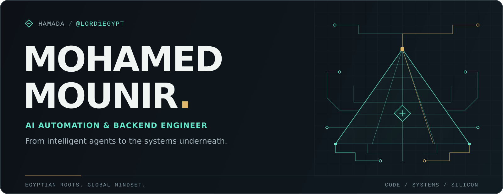
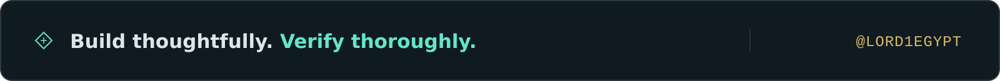

<picture>
  <source media="(max-width: 600px)" srcset="./assets/hero-mobile.svg">
  
</picture>

  <a href="#selected-work">Selected work</a> &nbsp;·&nbsp;
  <a href="#the-wider-ecosystem">The ecosystem</a> &nbsp;·&nbsp;
  <a href="#engineering-toolkit">Toolkit</a> &nbsp;·&nbsp;
  <a href="https://github.com/Lord1Egypt?tab=repositories">All repositories ↗</a>

### From intelligent agents to the systems underneath.

I'm **Mohamed Mounir — call me Hamada**, an Egyptian software developer working across **AI automation, backend engineering, and infrastructure**. My projects connect the layers: persistent memory for coding agents, developer environments on Android, language tools, blockchain software, and open silicon.

I care about understanding how things work, making them useful, and leaving enough evidence for the next person to reproduce the result.

  <b>أهلًا، أنا محمد منير — حمادة.</b> 
  مطوّر مصري ببني أدوات ذكاء اصطناعي وأنظمة خلفية وبنية تحتية، وبشتغل على Linux وAndroid والبلوكتشين وتصميم العتاد المفتوح. بحب أفهم النظام من جوّه، وأحوّل الأفكار لأدوات مفيدة وقابلة للتطوير.

## Selected work

A cross-section of the projects I build and maintain.

<table>
  <tr>
    <td width="50%" valign="top">
      
      <h3><a href="https://github.com/Lord1Egypt/ThothMemory">ThothMemory ↗</a></h3>
      
<b>Continuity for AI coding agents.</b>

      
Persistent project memory, decisions, evidence, and handoffs through MCP, with local SQLite and server-backed editions.

      
<code>Go</code> <code>MCP</code> <code>SQLite</code>

    </td>
    <td width="50%" valign="top">
      
      <h3><a href="https://github.com/Lord1Egypt/RA-Skills">RA-Skills ↗</a></h3>
      
<b>Agent skills, organized and searchable.</b>

      
A curated registry of community agent skills, with offline search, bundled skill folders, and Python and JavaScript tooling.

      
<code>Python</code> <code>JavaScript</code> <code>CLI</code>

    </td>
  </tr>
  <tr>
    <td width="50%" valign="top">
      
      <h3><a href="https://github.com/Lord1Egypt/ThothDock">ThothDock ↗</a></h3>
      
<b>Container workflows on Android.</b>

      
A Docker-compatible userspace engine for unrooted Android, using PRoot. Its environments share the host kernel and are not a security boundary.

      
<code>Go</code> <code>PRoot</code> <code>Android</code>

    </td>
    <td width="50%" valign="top">
      
      <h3><a href="https://github.com/Lord1Egypt/AndroidThothTerm">ThothTerm Android ↗</a></h3>
      
<b>A terminal that speaks your language.</b>

      
An Android terminal with real PTY sessions, extra keys, Unicode, and Arabic shaping and bidirectional text support.

      
<code>Android</code> <code>PTY</code> <code>Arabic / RTL</code>

    </td>
  </tr>
  <tr>
    <td width="50%" valign="top">
      
      <h3><a href="https://github.com/Lord1Egypt/PocketClaw">PocketClaw ↗</a></h3>
      
<b>An AI workspace in your pocket.</b>

      
An Android agent app with a Flutter interface and a PicoClaw-based Go core. Tools and the workspace run on the device; models connect remotely.

      
<code>Flutter</code> <code>Dart</code> <code>Go</code>

    </td>
    <td width="50%" valign="top">
      
      <h3><a href="https://github.com/Lord1Egypt/Heh">Heh ↗</a></h3>
      
<b>A language built around deliberate limits.</b>

      
A programming language and Rust toolchain exploring arbitrary-precision integers, static types, and capability-based I/O.

      
<code>Rust</code> <code>Language design</code>

    </td>
  </tr>
  <tr>
    <td width="50%" valign="top">
      
      <h3><a href="https://github.com/Lord1Egypt/KemetCore">KemetCore ↗</a></h3>
      
<b>An open-silicon laboratory.</b>

      
Hardware accelerator experiments spanning CPUs, ML, cryptography, and graphics, with Python models and RTL-to-GDSII workflows.

      
<code>SystemVerilog</code> <code>Python</code> <code>OpenROAD</code>

    </td>
    <td width="50%" valign="top">
      
      <h3><a href="https://github.com/Lord1Egypt/Khnum">Khnum ↗</a></h3>
      
<b>Memory building blocks, generated.</b>

      
A Python memory compiler for SRAM, register files, FIFOs, and ECC, with generated RTL, testbenches, and formal-verification support.

      
<code>Python</code> <code>Verilog</code> <code>FPGA / ASIC</code>

    </td>
  </tr>
</table>

## The wider ecosystem

The same curiosity shows up in inference tools, security research, emulation, and exact solvers.

<b>Explore more projects by domain</b>

| Domain | Projects & purpose |
| :--- | :--- |
| **AI & agent tooling** | [**Shu**](https://github.com/Lord1Egypt/Shu) — resource budgeting for local models. [**ThothMemory-Lite**](https://github.com/Lord1Egypt/ThothMemory-Lite) — a standalone SQLite memory service under development. [**Heka**](https://github.com/Lord1Egypt/Heka) — reusable operating conventions for coding agents. |
| **Blockchain & security** | [**Seshat**](https://github.com/Lord1Egypt/Seshat) — local smart-contract review and a SQLite findings archive. [**MaatEye**](https://github.com/Lord1Egypt/MaatEye) — heuristic contract scanning across EVM chains. [**elements-localnet**](https://github.com/Lord1Egypt/elements-localnet) — a Docker-based Elements development network. |
| **Android & Linux** | [**ProotX**](https://github.com/Lord1Egypt/ProotX) — Linux environments on Android, built on UserLAnd and PRoot. [**Hydra-Emulator**](https://github.com/Lord1Egypt/Hydra-Emulator) — Android app workflows on Windows using Electron and Android emulator tooling. |
| **Languages & algorithms** | [**combinatorial-forge**](https://github.com/Lord1Egypt/combinatorial-forge) — C++ exact solvers for finite games and puzzles, with reproducibility artifacts. [**ThothTerm**](https://github.com/Lord1Egypt/ThothTerm) — a Rust desktop-terminal project with WezTerm-derived rendering components. |
| **Hardware & simulation** | [**PtahCore**](https://github.com/Lord1Egypt/PtahCore) — FP8 tensor-accelerator research using an open RTL-to-GDSII flow. [**atum**](https://github.com/Lord1Egypt/atum) — a virtual-market simulation framework for studying artificial agents. |
| **Emulation & game systems** | [**DragonLord-Emulator**](https://github.com/Lord1Egypt/DragonLord-Emulator) — emulation work built on QEMU. [**ZATHROTH**](https://github.com/Lord1Egypt/ZATHROTH) — a Canary-based game server with SQLite and Docker deployment. |

Projects include original tools, integrations, and adaptations of open-source foundations. Each repository documents its own scope, status, limitations, and upstream credits.

## Engineering toolkit

**Languages** &nbsp; `Go` · `Rust` · `Python` · `C / C++` · `JavaScript` · `Dart` · `Java / Kotlin` · `SystemVerilog`

**Systems** &nbsp; `Linux` · `Android` · `Docker` · `PRoot` · `GitHub Actions`

**Data & interfaces** &nbsp; `MCP` · `HTTP APIs` · `SQLite` · `PostgreSQL` · `MariaDB`

## How I work

- **Understand the system.** Trace the cause, respect the architecture, and keep changes purposeful.
- **Make the work reproducible.** Document decisions, preserve useful evidence, and test the behavior that matters.
- **Keep complexity accountable.** Choose tools around real constraints: reliability, security, performance, and cost.

  <a href="https://github.com/Lord1Egypt?tab=repositories"><b>Explore the repositories →</b></a>

